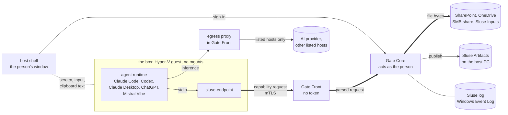

## Why

An AI agent with a person's access can reach everything that person can, and
nobody can say afterwards what it was given. So security teams say no.

Sluse moves the agent into a **box**, a Linux virtual machine on the
person's own Windows PC, with no filesystem mounts and no credential for
company data. **Sluse Gate** outside the box, acting as the signed-in person,
releases files from the places IT allowed: SharePoint, an SMB share, the
person's OneDrive `Sluse` folder or a local Sluse Inputs folder. What the
agent produces leaves the box one way, into a directory on the host PC
called **Sluse Artifacts** (`C:\Users\<person>\Sluse Artifacts`), naming the
files the agent says it used.

> [!IMPORTANT]
> **Sluse does not decide whether an AI model is trustworthy.** It limits
> what the agent can reach, and records every file that goes in and every
> result that comes out: authorised inputs with recorded provenance. It is
> **not** a data validator and **does not prevent exfiltration**: the agent
> talks to its AI provider, and anything it was given can go into that
> conversation. Every known channel is in [SECURITY.md](SECURITY.md).

## What it addresses

Each with its limit. The full table of what is and is not claimed is in
[SECURITY.md](SECURITY.md).

| Risk | What Sluse does | Where it stops |
| --- | --- | --- |
| **Excessive agent access** | The agent has no credential and no mount. It reaches only the folders IT listed, as the person, checked by Sluse Gate outside the box | Everything in scope is readable, and can go to the AI provider |
| **Accidental data discovery** | Outside the listed folders, nothing exists for the agent: out of scope answers as not found | Connectors on the provider's side (Microsoft 365 in Claude, apps in ChatGPT) reach around Sluse; the guide says to turn them off |
| **Uncontrolled file modification** | Read-only against every source. The one way out is a new folder in Sluse Artifacts, written all or nothing | Text copied out of the box, and hosts on the egress list that take uploads |
| **Loss of provenance** | Every admitted file is hashed and recorded in the Windows Event Log, outside the box. Every published file names its sources, each checked to be one the agent was given | Which sources were really used is the agent's word; text copied out carries none |
| **Long-lived agent credentials** | No token for company data in the box: the person's tokens stay in memory on the host, and Sluse's app registration has no secret | The AI runtime's own sign-in lives in the box |
| **Unlisted network destinations** | The box has no route and no DNS; a proxy on the host reaches the listed hosts by name, nothing else | A listed host that takes uploads is a way out |
| **Bulk collection** | Many files in a short time raise an alert | Detective only: the reads are not stopped |

## How it works

[](docs/images/how-it-works.gif)

*Select the picture for the animated version.*



| Component | Where | What it does |
| --- | --- | --- |
| `sluse-endpoint` | the box | The agent's only tools for company data, as an MCP server over stdio. Journals every admission. Holds no token, only its own mTLS key. |
| `sluse-gate-front` | the host, as LocalService | Gate Front, one per box: everything the box can reach. Ends the box's mTLS, parses every request before Gate Core sees it, runs the egress proxy. Holds no token and reads no file; it may refuse, only Gate Core may allow. Its start as LocalService is built, not yet run on a device. |
| `sluse-gate-core` | the host, as SYSTEM | Gate Core: checks every path against the admin's config (**enforcing**), reads every file as the person, writes publishes into Sluse Artifacts, records to the Sluse log, with what only Gate Front saw recorded as Front's claim. Holds the person's tokens in memory only. No network listener of its own. |
| lifecycle service | the host, as SYSTEM | Checks the PC's posture, builds the box on the device, opens, closes, resets and wipes it. |
| host shell | the host, as the person | The one window: the box's screen, input and clipboard text, no file channel. Signs the person in, so no token enters the box. |
| egress proxy | the host, in Gate Front | The box has no route and no DNS; the proxy lets it reach the config's listed hosts by name, nothing else. A listed host that takes uploads is a way out. |

- **Scope is enforced outside the box.** The box cannot assert its own scope,
  and Gate Core never exceeds the person's own access: the source's
  permissions have the last word.
- **Admission is the control point, not residence.** Once given, a file may
  stay on the box's disk until the person wipes the box.

More: [docs/architecture.md](docs/architecture.md).

### The agent's tools

| Tool | What it does |
| --- | --- |
| `sluse_sources` | The sources the agent can work with, and the paths in each that exist for it |
| `sluse_list` | A directory in a source; anything out of scope is absent, not refused |
| `sluse_read` | A text file, wrapped in an untrusted-data envelope |
| `sluse_fetch` | A copy into the box's workspace, to build or run; read back through `sluse_read`, it is enveloped again |
| `sluse_publish` | The single write path out: a delivery into Sluse Artifacts, each file with the sources the agent declares it used |

## Status

Run on a test device: install and updates through Intune; sign-in with no
app credential; SharePoint, OneDrive and SMB read as the person (one user,
one tenant); the egress proxy; publishing with declared sources checked
against what was admitted; Word, PDF, spreadsheets and slides read as text;
Claude Code and Claude Desktop end to end.

Built, not yet run on a device: the Sluse log accepting writes from SYSTEM
only, App Control on Sluse Artifacts, the check that the Windows user and
the signed-in user are the same person, and Codex, ChatGPT and Mistral
Vibe, wired like the other runtimes. What is open is listed as open, in
[GUIDE.md](GUIDE.md#known-edges-in-v01) and [SECURITY.md](SECURITY.md).

## Where this is going

A plan, not a promise: the pilots decide the order. Nothing here is claimed
until it is built and run, and then it moves to Status.

| Area | Today (v0.1) | Planned | When |
| --- | --- | --- | --- |
| Sources | SharePoint, the person's OneDrive `Sluse` folder, SMB shares and a local Sluse Inputs folder, read as the person | Internal tools and APIs as sources: MCP servers and tool calls through Gate Core, scoped per operation in the config, called as the person, recorded like a file. Read only first | v0.2, first |
| Writing back | None. The one way out is Sluse Artifacts | A writing operation only after the person confirms it in the host's window, which the agent cannot draw over | after tool calls |
| The providers' connectors | Connectors such as Microsoft 365 in Claude, or apps in ChatGPT, read company data from the provider's cloud, around Sluse. The guide says to turn them off; Sluse cannot check | Sluse Admin reads the tenant's consent and assignment for the providers' apps and warns when they are open | v0.2 |
| Agent runtimes | Claude Code and Claude Desktop, run end to end. Codex, ChatGPT and Mistral Vibe installed, not checked | Both checked | when each can be tested |
| The provider's credential | Each runtime signs in inside the box; Sluse cannot see which account | The credential held on the host, none in the box, for runtimes that take a key or a token | when a pilot needs it |
| Egress | Default deny; the box reaches only listed hosts, by name. A listed host that takes uploads is a way out | Method and path rules on such hosts, so one like GitHub can be allowed in part. A company's own upstream proxy | when a pilot needs it |
| Files in the box | They stay until the person clears or wipes the box | Finding admitted files moved out of the workspace, by hash (advisory). A spike on confining the command-line runtimes' writes to the workspace; a claim only if it holds | after the pilots |
| The Sluse log | The Windows Event Log, written by SYSTEM only | A documented query for a box that reads much and publishes little | after the pilots |
| Releases | An unsigned MSI with `SHA256SUMS`, third-party notices inside | Code signing | v0.2 |

## Install

The [latest release](https://github.com/Git-SerenIT/Sluse/releases/latest)
is the pilot release. An admin sets Sluse up with **Sluse Admin** and
deploys it through Intune; the box is built on each PC from Canonical's
Ubuntu image, with no shipped image.

**Needs, on each host PC:** Windows 11 Pro, Enterprise or Education with
Hyper-V-capable hardware, Entra-joined and managed by Intune, and 16 GB of
memory or more; the box takes 6 GB of it while open, by default.

Setting up, working in it, and what IT sees: [GUIDE.md](GUIDE.md).

## Build

```sh
cargo build --workspace
cargo test  --workspace
npm --prefix ui/console ci && npm --prefix ui/console run check
```

Windows binaries and the MSI are built by CI. See
[CONTRIBUTING.md](CONTRIBUTING.md).

## Docs

| | |
| --- | --- |
| [GUIDE.md](GUIDE.md) | For IT and the person using it: setting up, working in it, what IT sees, the known edges |
| [SECURITY.md](SECURITY.md) | What is claimed and not, the invariants, the known channels, reporting a vulnerability |
| [docs/architecture.md](docs/architecture.md) | Components, trust boundaries, the data flow |
| [CONTRIBUTING.md](CONTRIBUTING.md) | Building, testing, the layout |

## License

[Apache License 2.0](LICENSE). Copyright 2026 SerenIT ApS and Prompted EV;
see [NOTICE](NOTICE). The licence does not grant use of the Sluse name or
logo (Apache-2.0 §6).

Built with AI assistance (Claude Code).
