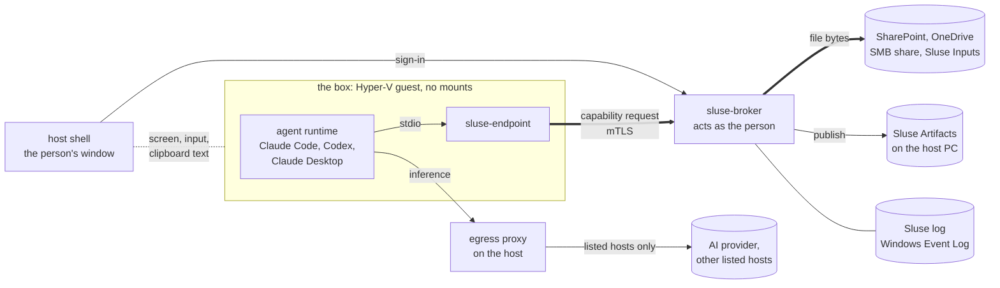

# Sluse

A contained environment for an AI agent working on company data. The agent
runs in a box with no access of its own; Sluse hands it files one at a time,
as the person using it, and records each one.

## Why

An AI agent with a person's access can reach everything that person can, and
nobody can say afterwards what it was given. So security teams say no.

Sluse moves the agent into a **box**, a Linux virtual machine on the
person's own Windows PC, with no filesystem mounts and no credential for
company data. A **broker** outside the box, acting as the signed-in person,
releases files from the places IT allowed: SharePoint, an SMB share, the
person's OneDrive `Sluse` folder or a local Sluse Inputs folder. What the
agent produces leaves the box one way, into a directory on the host PC
called **Sluse Artifacts** (`C:\Users\<person>\Sluse Artifacts`), naming the
files the agent says it used.

> [!IMPORTANT]
> **The claim is authorised inputs with recorded provenance.** Every file the
> agent got was one IT allowed and the person could open, and it is recorded.
> Sluse is **not** a data validator and **does not prevent exfiltration**: the
> agent talks to its AI provider, and anything it was given can go into that
> conversation. What is and is not claimed, and every known channel, is in
> [SECURITY.md](SECURITY.md).

## How it works



| Component | Where | What it does |
| --- | --- | --- |
| `sluse-endpoint` | the box | The agent's only tools for company data, as an MCP server over stdio. Journals every admission. Holds no token, only its own mTLS key. |
| `sluse-broker` | the host, as SYSTEM | Checks every path against the admin's config (**enforcing**), reads every file as the person, writes publishes into Sluse Artifacts, records to the Sluse log. Holds the person's tokens in memory only. |
| lifecycle service | the host, as SYSTEM | Checks the PC's posture, builds the box on the device, opens, closes, resets and wipes it. |
| host shell | the host, as the person | The one window: the box's screen, input and clipboard text, no file channel. Signs the person in, so no token enters the box. |
| egress proxy | the host | The box has no route and no DNS; the proxy lets it reach the config's listed hosts by name, nothing else. A listed host that takes uploads is a way out. |

- **Scope is enforced outside the box.** The box cannot assert its own scope,
  and the broker never exceeds the person's own access: the source's
  permissions have the last word.
- **Admission is the control point, not residence.** Once given, a file may
  stay on the box's disk until the person wipes the box.

More: [docs/architecture.md](docs/architecture.md).

### The agent's tools

| Tool | What it does |
| --- | --- |
| `sluse_sources` | The sources the agent can work with, and the paths in each that exist for it |
| `sluse_list` | A directory in a source; anything out of scope is absent, not refused |
| `sluse_read` | A text file, wrapped in an untrusted-data envelope |
| `sluse_fetch` | A copy into the box's workspace, to build or run; read back through `sluse_read`, it is enveloped again |
| `sluse_publish` | The single write path out: a delivery into Sluse Artifacts, each file with the sources the agent declares it used |

Claude Code and Claude Desktop are driven end to end on our test device.
Codex is installed and wired the same way and not yet checked.

## Status

Run on a test device: install and updates through Intune; sign-in with no
app credential; SharePoint, OneDrive and SMB read as the person (one user,
one tenant); the egress proxy; publishing with declared sources checked
against what was admitted; Word, PDF, spreadsheets and slides read as text.

Built, not yet run on a device: the Sluse log accepting writes from SYSTEM
only, App Control on Sluse Artifacts, and the check that the Windows user and
the signed-in user are the same person. What is open is listed as open, in
[GUIDE.md](GUIDE.md#known-edges-in-v01) and [SECURITY.md](SECURITY.md).

## Install

There is no release yet. When there is, an admin sets Sluse up with **Sluse
Admin** and deploys it through Intune; the box is built on each PC from
Canonical's Ubuntu image, with no shipped image.

**Needs:** Windows 11 Pro, Enterprise or Education with Hyper-V-capable
hardware, Entra-joined and managed by Intune, 16 GB of memory or more.

Setting up, working in it, and what IT sees: [GUIDE.md](GUIDE.md).

## Build

```sh
cargo build --workspace
cargo test  --workspace
npm --prefix ui/console ci && npm --prefix ui/console run check
```

Windows binaries and the MSI are built by CI. See
[CONTRIBUTING.md](CONTRIBUTING.md).

## Docs

| | |
| --- | --- |
| [GUIDE.md](GUIDE.md) | For IT and the person using it: setting up, working in it, what IT sees, the known edges |
| [SECURITY.md](SECURITY.md) | What is claimed and not, the invariants, the known channels, reporting a vulnerability |
| [docs/architecture.md](docs/architecture.md) | Components, trust boundaries, the data flow |
| [CONTRIBUTING.md](CONTRIBUTING.md) | Building, testing, the layout |

## License

[Apache License 2.0](LICENSE). Copyright 2026 SerenIT ApS and Prompted EV;
see [NOTICE](NOTICE). The licence does not grant use of the Sluse name or
logo (Apache-2.0 §6).

Built with AI assistance (Claude Code).
