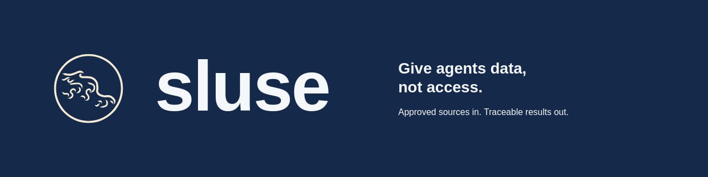

## The short version

Your company's IT environment is a sea, full of data fish. Some of them are
protected species. AI agents are fishermen, and given the chance, they fish
with a bottom trawl. Anything within reach can end up in the net. Bycatch
included.

How do you keep agents away from the protected species? How do you know
what they caught?

Our answer is a sluice.

- **You decide which waters the sluice draws from.** Outside them, there
  are no fish as far as the agent can tell.
- **Every fish is counted on the way through,** and the tally is kept on
  shore, out of the agent's reach.
- **The agent never touches the sea through the sluice.** Fish are brought to
  the agent on demand, if they are allowed in.
- **The catch comes ashore in one place:** Sluse Artifacts. The other ways
  out are the ones you leave open: copying text out of the box, and hosts
  on your list that take uploads.
- **The agent labels its own crates,** and Sluse checks that it only lists
  fish it was actually given.

Sluse won't stop the agent from telling its AI provider about the catch.
But it does limit what the catch can contain.

> [!IMPORTANT]
> **Sluse does not decide whether an AI model is trustworthy.** It limits
> what the agent can reach, and records every file that goes in and every
> result that comes out: authorised inputs with recorded provenance. It is
> **not** a data validator and **does not prevent exfiltration**: the agent
> talks to its AI provider, and anything it was given can go into that
> conversation. Every known channel is in [SECURITY.md](SECURITY.md).

In practice, Sluse moves the agent into a **box**, a Linux virtual machine
on the person's own Windows PC, with no filesystem mounts and no credential
for company data. **Sluse Gate**, outside the box and acting as the
signed-in person, releases files from the places IT allowed: SharePoint, an
SMB share, the person's OneDrive `Sluse` folder, a local Sluse Inputs folder
or a tool server (MCP). What the agent publishes lands in a folder on the PC
called **Sluse Artifacts** (`C:\Users\<person>\Sluse Artifacts`), naming
the files the agent says it used.

## What it addresses

Each with its limit. The full table of what is and is not claimed is in
[SECURITY.md](SECURITY.md).

| Risk | What Sluse does | Where it stops |
| --- | --- | --- |
| **Excessive agent access** | The agent has no credential and no mount. It reaches only the folders IT listed, as the person, checked by Sluse Gate outside the box | Everything in scope is readable, and can go to the AI provider |
| **Accidental data discovery** | Outside the listed folders, nothing exists for the agent: out of scope answers as not found | Connectors on the provider's side (Microsoft 365 in Claude, apps in ChatGPT) reach around Sluse; the guide says to turn them off |
| **Uncontrolled file modification** | Read-only against every source. The one way out is a new folder in Sluse Artifacts, written all or nothing | Text copied out of the box, and hosts on the egress list that take uploads |
| **Loss of provenance** | Every admitted file is hashed and recorded in the Windows Event Log, outside the box. Every published file names its sources, each checked to be one the agent was given | Which sources were really used is the agent's word; text copied out carries none |
| **Long-lived agent credentials** | No token for company data in the box: the person's tokens stay in memory on the host, and Sluse's app registration has no secret | The AI app's own sign-in lives in the box. Where IT turns on Microsoft sign-in, a Microsoft session can too, in the minutes the person opens it; outside the box only Conditional Access refuses it |
| **Unlisted network destinations** | The box has no route and no DNS; a proxy on the host reaches the listed hosts by name, nothing else | A listed host that takes uploads is a way out |
| **Bulk collection** | Many files in a short time raise an alert | Detective only: the reads are not stopped |

## How it works

![How Sluse works. The box gets files, not access. On the Windows PC, the box holds the agent and Sluse tools, the agent's only way to company data. 1: the agent asks for a file through its Sluse tools, which reach Gate Front: no token, the box's TLS, every request parsed, the egress proxy. Gate Front passes the parsed request to Gate Core, which checks scope and reads as you, and holds your Microsoft sign-in, not the box. 2: Sluse Gate checks scope and reads the file as you from the sources IT listed: SharePoint, OneDrive, file shares, Sluse Inputs on your PC, tool servers (MCP). 3: every admission is recorded in the Sluse log. 4: results are published to Sluse Artifacts with the sources they used. The agent's inference goes through Gate Front to its AI provider, and what it was given can go into that conversation.](docs/images/how-it-works.png)

| Component | Where | What it does |
| --- | --- | --- |
| `sluse-endpoint` | the box | The agent's only tools for company data, as an MCP server over stdio. Journals every admission. Holds no token, only its own mTLS key. |
| `sluse-gate-front` | the host, as LocalService | Gate Front, one per box: everything the box can reach. Ends the box's mTLS, parses every request before Gate Core sees it, runs the egress proxy. Holds no token and reads no file; it may refuse, only Gate Core may allow. |
| `sluse-gate-core` | the host, as SYSTEM | Gate Core: checks every path against the admin's config (**enforcing**), reads every file as the person, writes publishes into Sluse Artifacts, records to the Sluse log, with what only Gate Front saw recorded as Front's claim. Holds the person's tokens in memory only. No network listener of its own. |
| lifecycle service | the host, as SYSTEM | Checks the PC's posture, builds the box on the device, opens, closes, resets and wipes it. |
| host shell | the host, as the person | The one window: the box's screen, input and clipboard text, no file channel. Signs the person in, so no token enters the box. |
| egress proxy | the host, in Gate Front | The box has no route and no DNS; the proxy lets it reach the config's listed hosts by name, nothing else. A listed host that takes uploads is a way out. |

- **Scope is enforced outside the box.** The box cannot assert its own scope,
  and Gate Core never exceeds the person's own access: the source's
  permissions have the last word.
- **Admission is the control point, not residence.** Once given, a file may
  stay on the box's disk until the person wipes the box.

The component diagram and more: [docs/architecture.md](docs/architecture.md).

### The agent's tools

| Tool | What it does |
| --- | --- |
| `sluse_sources` | The sources the agent can work with, and the paths in each that exist for it |
| `sluse_list` | A directory in a source; anything out of scope is absent, not refused |
| `sluse_read` | A text file, wrapped in an untrusted-data envelope |
| `sluse_fetch` | A copy into the box's workspace, to build or run; read back through `sluse_read`, it is enveloped again |
| `sluse_publish` | The single write path out: a delivery into Sluse Artifacts, each file with the sources the agent declares it used |

## Status

Run on a test device: install and updates through Intune; sign-in with no
app credential; SharePoint, OneDrive and SMB read as the person (one user,
one tenant); the egress proxy; publishing with declared sources checked
against what was admitted; Word, PDF, spreadsheets and slides read as text;
Claude Code, Claude Desktop, ChatGPT and Codex end to end, Claude Code and
Codex refusing an account outside the organisation; a tool server called as
the person, only the tools the admin ticked; Sluse Admin reading whether the
AI providers' Microsoft 365 connectors are open in the tenant; Mistral Vibe
with models from the configuration; the clipboard's records.

Built, not yet run on a device: the Sluse log accepting writes from SYSTEM
only, App Control on Sluse Artifacts, the check that the Windows user and
the signed-in user are the same person, and a closed box taking its
update at the next open. What is open is listed as open, in
[GUIDE.md](GUIDE.md#known-edges) and [SECURITY.md](SECURITY.md).

## Where this is going

A plan, not a promise. Nothing here is claimed until it is built and run,
and then it moves to Status.

- **0.3:** the box's console drawn by Sluse's own program instead of a
  browser, so a browser update cannot take the box's screen away, and the
  console's local port, which any program in the box could call, goes.
- **0.4:** code signing, built and waiting on the certificate's identity
  check. And the connections a Sluse Platform will need, **to be done**: a
  paid platform for running Sluse at scale (teams, a configuration per team,
  compliance reporting) is planned, and what it needs from the open-source
  box is found out before anything is built for it.
- **After 0.4, the pilots decide** what comes next, by what they need. The
  candidates known today:

| Area | Today | Candidate |
| --- | --- | --- |
| Writing back | None through Sluse's own tools; the one way out is Sluse Artifacts. A tool server's tool that writes is the admin's to tick, and Sluse cannot tell it from one that reads | A writing operation only after the person confirms it in the host's window, which the agent cannot draw over |
| Egress | Default deny; the box reaches only listed hosts, by name. A listed host that takes uploads is a way out | Method and path rules on such hosts, so one like GitHub can be allowed in part. A company's own upstream proxy |
| Files in the box | They stay until the person clears or wipes the box | Finding admitted files moved out of the workspace, by hash (advisory). A spike on confining the command-line runtimes' writes to the workspace; a claim only if it holds |
| The Sluse log | The Windows Event Log, written by SYSTEM only | A documented query for a box that reads much and publishes little |

## Install

The [latest release](https://github.com/Git-SerenIT/Sluse/releases/latest)
is the pilot release. An admin sets Sluse up with **Sluse Admin** and
deploys it through Intune; the box is built on each PC from Canonical's
Ubuntu image, with no shipped image.

**Needs, on each host PC:** Windows 11 Pro, Enterprise or Education with
Hyper-V-capable hardware, Entra-joined and managed by Intune, and 16 GB of
memory or more; the box takes 6 GB of it while open, by default.

Setting up, working in it, and what IT sees: [GUIDE.md](GUIDE.md).

## Build

```sh
cargo build --workspace
cargo test  --workspace
```

Windows binaries and the MSI are built by CI. See
[CONTRIBUTING.md](CONTRIBUTING.md).

## Docs

| | |
| --- | --- |
| [GUIDE.md](GUIDE.md) | For IT and the person using it: setting up, working in it, what IT sees, the known edges |
| [SECURITY.md](SECURITY.md) | What is claimed and not, the invariants, the known channels, reporting a vulnerability |
| [docs/architecture.md](docs/architecture.md) | Components, trust boundaries, the data flow |
| [CONTRIBUTING.md](CONTRIBUTING.md) | Building, testing, the layout |

## License

[Apache License 2.0](LICENSE). Copyright 2026 SerenIT ApS and Prompted EV;
see [NOTICE](NOTICE). The licence does not grant use of the Sluse name or
logo (Apache-2.0 §6).

Built with AI assistance (Claude Code).
