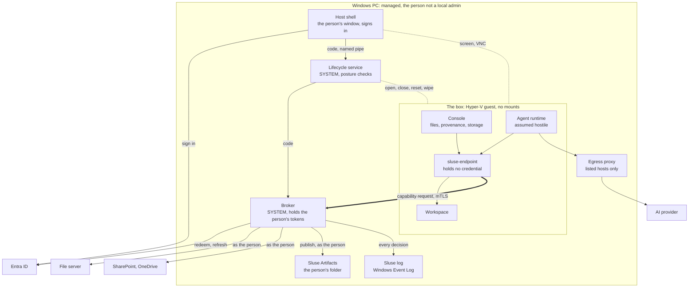

# Architecture

How Sluse is put together: the components, where each runs and what it is
trusted with, and the two flows that matter, admission and publish. What
is claimed, and every known channel, is in [SECURITY.md](../SECURITY.md).

- [Shape](#shape)
- [Components](#components)
- [Trust zones](#trust-zones)
- [Sign-in](#sign-in)
- [Admission](#admission)
- [Publish and provenance](#publish-and-provenance)
- [The box](#the-box)
- [Two products, one schema](#two-products-one-schema)

## Shape

The box is a Hyper-V guest on a managed Windows PC: **local**,
**persistent**, **read-only against every source**, with **no filesystem
mounts in either direction**. It reaches the host over a host-only network
with mutual TLS, and nothing else lives on that network. The box has no
route out, no NAT and no DNS.

## Components

| Component | Where | Role |
|---|---|---|
| Agent runtime | the box | Claude Code, Claude Desktop, Codex or Mistral Vibe. Assumed hostile; may run as root. Never sees a token for company data. |
| `sluse-endpoint` | the box | The only boundary crossing for file content. An MCP server over stdio: the agent's tools, the admission journal, the envelope on reads, the sources declared on publish. Its scope checks are advice only. |
| Console | the box | What Sluse let in, what was published and from what, the copies in the box, the sources. Shown only what the agent may see. |
| Workspace | the box | Admitted files and the agent's output, on the box's own disk. Kept until the person clears it or wipes the box. |
| Host shell | the host, as the person | The person's one window: the box's screen, input and clipboard text, no file channel. Signs the person in. With `--admin`, it is Sluse Admin. |
| Lifecycle service | the host, SYSTEM | Checks the PC's posture before a start, builds the box's base on the device, opens, closes, resets and wipes boxes. The person is never in Hyper-V Administrators. |
| Broker | the host, SYSTEM | Holds the person's tokens in memory only. Authenticates the endpoint over mTLS, checks every path against the config (**enforcing**), reads the source as the person, streams the bytes, writes publishes, records every decision. One per box. |
| Egress proxy | the host | Default-deny by host name, from the config's egress list. `CONNECT` to 443 and plain HTTP to 80 only, never an address or a name resolving to a private one. Runs on the host, so it holds against a privileged agent. |
| Sluse Artifacts | the host | The single write path out: `%USERPROFILE%\Sluse Artifacts`, written as the person, one folder per publish, never mounted in the box. |
| Sluse log | the host | A Windows Event Log of its own, written by the broker: the record the design trusts. |
| Sluse Admin (`sluse-admin`) | the admin's PC | Sluse's Entra app registration, consent, the sources and their scopes, the egress list, the config and the Intune package. |

## Trust zones

From least to most trusted:

1. **The box.** Assumed hostile. There is no durable secret for company
   data to steal: the agent gets one admission at a time, in flight. The
   endpoint's journal lives here; it serves provenance and is not the
   record the design trusts.
2. **The host services.** The service, the broker and the proxy run as
   SYSTEM, are configured by Intune, and cannot be reconfigured by the
   person. The broker's Sluse log is the trusted record.
3. **Sources and identity.** Entra, SharePoint, the file server. Their
   permissions, checked against the person's own identity, have the last
   word.

The box's authority never exceeds the person's own. That is structural,
not a check: the broker *is* the person, minus the paths it refuses.

## Sign-in

The shell signs the person in to Entra, by single sign-on where the PC
allows it and Microsoft's page where not. It hands the authorisation code to
the service over a named pipe, and the service hands it to the broker,
which redeems and refreshes it as a **public client**: Sluse's app
registration has no secret and no certificate. No token enters the box or
the shell. Who Sluse reads as, and Sign out, are shown in the shell's bar,
on the host, where nothing in the box can draw over them.

File shares and Sluse Inputs are read as the person's Windows logon, not
the Entra token. Sluse refuses them, and publishing, when the two are not
the same person (built, not yet run on a device).

## Admission

1. The **agent** calls `sluse_read` or `sluse_fetch` with a path. It cannot
   reach a source any other way.
2. The **endpoint** relays the request to the broker over mTLS, with the
   box's certificate and a session id. It holds no token.
3. The **broker** checks the path against the scopes in the config. A
   refusal here is enforcing, because the broker is outside the box, and
   is recorded. Out of scope and nonexistent answer the same, so the
   agent learns nothing from the difference.
4. The **broker** reads as the person: their Entra token for SharePoint and
   OneDrive, their Windows token for file shares and Sluse Inputs. It never
   asks whether the person may read a file; it reads as them and lets the
   source refuse.
5. The **source** decides: deny entries, nested groups and the rest are the
   file server's or Graph's, never reimplemented.
6. The broker streams the bytes and hashes them; the endpoint hashes what
   it received and journals the path, hash and session. The broker records
   the admission in the Sluse log.

A `read` returns text inside the untrusted-data envelope; Word, PDF,
spreadsheets and slides are returned as their text. A `fetch` writes the
bytes into the workspace, whole or not at all, with a sidecar naming the
admission, and returns the path. An agent reading that file directly gets
no envelope.

## Publish and provenance

1. The **agent** calls `sluse_publish` with one or more files, each naming
   the sources it says it used. A document can come as Markdown to be
   rendered to Word or PowerPoint in the box.
2. The **endpoint** checks each declared source against the session's
   journal and attaches every admission of the session.
3. The **broker** refuses a delivery whose declared sources are not all
   among the reads and fetches it completed in the session, and records its
   own set, not the endpoint's.
4. The broker writes the delivery into **Sluse Artifacts** as the person,
   all or nothing, into a new folder, every file marked as from the
   internet. Where the admin deployed it, App Control blocks executables
   there; scripts are not blocked.
5. Each file's hash, its declared sources and the session's admitted set go
   into the journal and the Sluse log. Nothing is written into the
   document itself.

**Provenance pins the content hash at admission, not the path**, so
lineage survives the source changing and makes it detectable. An artifact
carries two lists:

- **The sources the agent declared,** per file: the agent's word, checked
  only to be admissions of the session.
- **Everything admitted in the session,** from the broker's own record. It
  over-claims on purpose: a reader can narrow a superset, never widen a
  subset.

## The box

- **Built on the device, not shipped.** The service downloads Canonical's
  Ubuntu image, checks its signature and checksum, converts it, and runs
  one cloud-init build in a build VM. The build's last act is a verdict:
  a base without Sluse, Claude Desktop, Claude Code or the console is not
  kept; Codex and Mistral Vibe are left out when their egress groups were
  off. That disk,
  read-only, is the device's base.
- **One box per person,** one running at a time: a system disk on the base
  and a home disk of its own. The base has sway (in tabs), Firefox for the
  console, Claude Desktop, Claude Code, Codex, Mistral Vibe (when PyPI is
  reachable at its build), pandoc and poppler, and the Sluse bundle. No SSH server; the desktop user has no password and no
  sudo.
- **Its identity, at each open:** the service writes a one-time token into
  the box's Hyper-V key-value pool; the box trades it at the broker's
  enrolment port for a certificate and the config. The broker accepts only
  that certificate, and its own service's.
- **The screen** is a headless compositor with a VNC server on the
  host-only network. A new VNC secret at every open, which the person never
  sees; the box's firewall takes VNC from the host alone.
- **Reset** gives the box a fresh system disk on the newest base and keeps
  the home disk. **Wipe** replaces both. **Updates** arrive as a new base,
  built beside the old one, and the person moves onto it with a reset;
  never automatically.
- **The box's journal is mirrored to the host** as it is written, so a wipe
  keeps the record.
- **Not supported:** an agent running outside the box. Containment needs the
  agent's whole tool environment inside. Claude Desktop's Cowork does not
  run, because Hyper-V gives the box no nested virtualisation.

## Two products, one schema

| Relationship | Product | Licence |
|---|---|---|
| One person, many sources, read-only | The box (this repository) | Apache-2.0 |
| Many people, many sources, write-back | The platform, later | proprietary |

The config schema is the boundary: the box consumes it, the platform will
produce it. Sluse Admin writes one config per deployment, and the box runs
any valid config, so the platform needs no fork of the box. Configs per
team or person, fleet views and compliance reporting are the platform's.
